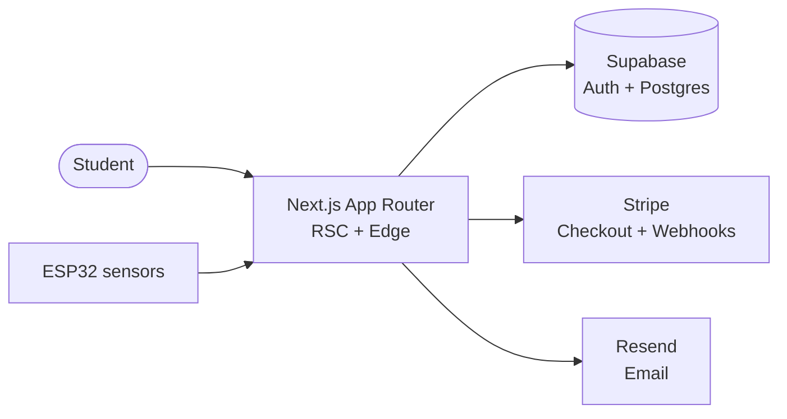

<picture>
  <source media="(prefers-color-scheme: dark)" srcset="./assets/banner-dark.svg">
  <source media="(prefers-color-scheme: light)" srcset="./assets/banner-light.svg">
  
</picture>

  
  
  
  

🇧🇷 Versão em português no final da página

 

### Hi, I'm Lucas 👋

I'm a software engineer who takes ideas from **blank page to production**: full-stack web platforms, data pipelines on the cloud and products that work for everyone, including people with disabilities.

I shipped and run **[Exatas Libras](https://exataslibras.com.br/)**, a paid learning platform for the Deaf community (Next.js, Supabase, Stripe), and I teach programming and game development. As the son of Deaf parents, accessibility isn't a checkbox for me: it's where I come from. 🤟

 

## What I can help you with

<table>
  <tr>
    <td width="33%" valign="top">
      <h4>🧩 Full-Stack Web Apps</h4>
      SaaS, dashboards, membership sites and MVPs with <b>Next.js</b>, <b>React</b> and <b>TypeScript</b>. Auth, payments (<b>Stripe</b>), emails and deploy on <b>Vercel</b>, done right from day one.
    </td>
    <td width="33%" valign="top">
      <h4>📊 Data Engineering</h4>
      ETL pipelines, data lakes and reporting with <b>Python</b>, <b>Pandas</b>, <b>SQL</b> and <b>AWS</b> (S3, Glue). Turning messy data into something your team can trust and use.
    </td>
    <td width="33%" valign="top">
      <h4>♿ Accessible Products</h4>
      Inclusive interfaces, accessibility reviews and assistive tech, from <b>Libras</b> (Brazilian Sign Language) content to computer-vision research for sign recognition.
    </td>
  </tr>
  <tr>
    <td width="33%" valign="top">
      <h4>🗄️ Backend &amp; APIs</h4>
      REST APIs and backends with <b>Django</b>, <b>Flask</b>, <b>.NET</b> and <b>Supabase/PostgreSQL</b>, with clean data models and secure access control.
    </td>
    <td width="33%" valign="top">
      <h4>🎮 Games &amp; Interactive</h4>
      Educational and narrative games with <b>Unity</b>, <b>Godot</b> and <b>C#</b>, plus real-time apps with <b>Firebase</b>.
    </td>
    <td width="33%" valign="top">
      <h4>🔌 IoT &amp; Hardware</h4>
      Prototypes with <b>ESP32</b>, <b>Arduino</b> and <b>Raspberry Pi</b>, sending sensor data straight into web dashboards.
    </td>
  </tr>
</table>

 

## Featured case study · Exatas Libras

**The problem.** Deaf students in Brazil rarely find math and science content taught in their first language, Libras.

**What I built.** A complete learning platform where Libras is the primary language: course catalog, MDX blog, paid subscriptions and analytics. I designed the architecture and wrote the code, end to end.

**Highlights**
- ⚡ Next.js App Router with React Server Components for fast navigation
- 🔐 Supabase Auth + Postgres with secure access control
- 💳 Stripe Checkout and webhooks managing subscriptions automatically
- ✉️ Transactional email with Resend, monitoring with Vercel Analytics
- 📡 v2.0: ESP32 sensors feeding hands-on lab data into the platform

<a href="https://exataslibras.com.br/"><b>→ Visit exataslibras.com.br</b></a>

 

## Selected work

| | Project | What it is | Stack | Link |
|:-:|---|---|---|---|
| 🎓 | **Exatas Libras** | Accessible learning platform for the Deaf community | Next.js · Supabase · Stripe · IoT | [Live ↗](https://exataslibras.com.br/) |
| 🔊 | **AudioRadar** | Sound-accessibility app with real-time sync | Firebase · Real-time | [Live ↗](https://vradar.com.br/) |
| 🌊 | **Guardiãs das Águas** | Narrative educational game about environmental awareness | Game dev · Storytelling | [Play ↗](https://senaigamehub.vercel.app/) |
| 🗂️ | **AWS Data Lake** | Data lake and ETL pipelines for analytics | AWS S3 · Glue · Python · Pandas | In progress |
| 🤟 | **Sign Language AI** | Computer vision to recognize and translate Libras signs | Python · Computer Vision | Research |

 

## Tech stack

  <b>Languages</b> 
  

  <b>Frameworks</b> 
  

  <b>Data &amp; Cloud</b> 
  

  <b>Games, Hardware &amp; Tools</b> 
  

  <b>Currently learning</b> 
  

 

## How I work

- **Clear communication.** Short, regular updates and no surprises. I explain technical trade-offs in plain language.
- **Ownership.** I care about the result in production, not just the ticket: performance, security and maintainability included.
- **Teacher's mindset.** I document what I build so your team can keep moving after the handoff.

 

<b>📈 GitHub activity</b>

 

<picture>
  <source media="(prefers-color-scheme: dark)" srcset="https://raw.githubusercontent.com/lucaslopes-ti/lucaslopes-ti/output/github-snake-dark.svg">
  <source media="(prefers-color-scheme: light)" srcset="https://raw.githubusercontent.com/lucaslopes-ti/lucaslopes-ti/output/github-snake.svg">
  
</picture>

  
  

<b>🇧🇷 Em português</b>

 

### Olá, eu sou o Lucas 👋

Sou engenheiro de software e levo ideias **do zero até a produção**: plataformas web full-stack, pipelines de dados na nuvem e produtos que funcionam para todo mundo, inclusive pessoas com deficiência.

Criei e mantenho a **[Exatas Libras](https://exataslibras.com.br/)**, plataforma de ensino de exatas para a comunidade surda, com Libras como idioma principal (Next.js, Supabase, Stripe). Também sou professor de informática e desenvolvimento de jogos, e pesquiso soluções de acessibilidade em Libras. Como filho de pais surdos, tecnologia inclusiva faz parte da minha história. 🤟

**Como posso ajudar:** aplicações web e MVPs, engenharia de dados (ETL, data lakes, AWS), APIs e backends, produtos acessíveis, jogos educativos e protótipos IoT.

Fora do código, você me encontra jogando videogame, imprimindo em 3D ou inventando algum projeto de hardware novo.

📩 Vamos conversar: [LinkedIn](https://www.linkedin.com/in/lucaslopes-ti/) · [lucas.dalps@gmail.com](mailto:lucas.dalps@gmail.com)

 

### Have a project in mind?

I'm open to freelance projects and remote roles. Tell me what you're building and let's talk.

